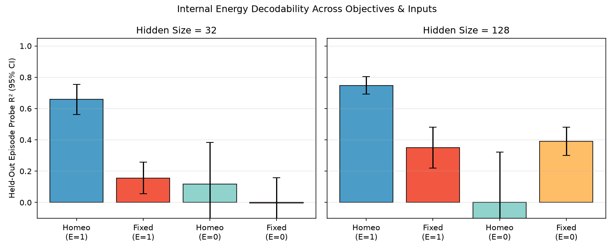
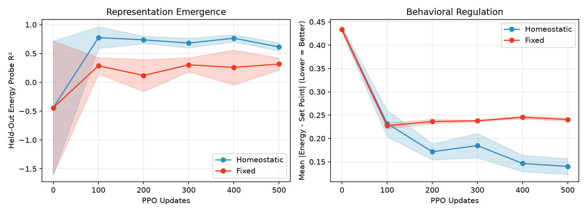

# Homeostatic Representation Learning in Recurrent RL

This repository investigates how a homeostatic drive-reduction objective (Keramati & Gutkin, 2014) shapes the learned internal-state representation and causal use of need in a recurrent GRU actor-critic agent trained with custom PPO.

## Experimental Design
- **Environment:** Partially observable 2D gridworld (`11x11` grid, `5x5` egocentric view) with metabolic energy decay, food, and toxins.
- **Training Matrix (64 runs):** 2 objectives (`homeostatic` vs. `fixed` reward) x 2 input conditions (`energy` observed vs. hidden) x 2 GRU hidden sizes (`32`, `128`) x 8 random seeds.
- **Analysis:** Episode-split linear probes (95% CI), training-time emergence across checkpoints, and causal hidden-state steering with a random-direction control.

## Key Results

### 1. Objective Shapes Internal-State Decodability

### 2. Representation Emergence Precedes Refined Regulation

### 3. Causal Steering Along the Energy Axis

## How to Reproduce
1. Install dependencies: `pip install torch gymnasium numpy scikit-learn matplotlib`
2. Train all 64 runs in parallel: `python3 run_matrix.py`
3. Run probes, emergence, and steering analysis: `python3 evaluate.py` and `python3 steering_control.py`
